# GarudaDeck Installer

<p align="center">
  
</p>

<p align="center">
  
  
  
  
  
</p>

<p align="center"><b>Installer panel Garuda Deck 1.15.2.</b></p>

Installer satu perintah untuk memasang panel **Garuda Deck 1.15.2 penuh**. Nama installer tetap **GarudaDeck**, lisensi MIT.

Hasil akhir: login berfoto Garuda Deck, nama tampil **Garuda Deck** di semua tampilan.

## Install

```bash
bash <(curl -fsSL https://raw.githubusercontent.com/Verlangid11/garudadeck-theme/main/install.sh)
```

Menu angka:

1. Install panel Garuda Deck 1.15.2
2. Cek VPS dan panel, tanpa mengubah apa pun
3. Backup saja, aman sebelum ubah
4. Rollback ke backup terakhir
5. Keluar

Aksi langsung:

```bash
bash <(curl -fsSL https://raw.githubusercontent.com/Verlangid11/garudadeck-theme/main/install.sh) check
bash <(curl -fsSL https://raw.githubusercontent.com/Verlangid11/garudadeck-theme/main/install.sh) backup
bash <(curl -fsSL https://raw.githubusercontent.com/Verlangid11/garudadeck-theme/main/install.sh) rollback
```

Panel di path lain:

```bash
PANEL_DIR=/var/www/panel bash <(curl -fsSL https://raw.githubusercontent.com/Verlangid11/garudadeck-theme/main/install.sh)
```

Mode hemat info:

```bash
QUIET=1 bash <(curl -fsSL https://raw.githubusercontent.com/Verlangid11/garudadeck-theme/main/install.sh)
```

## Yang dilakukan installer

1. Cek kompatibilitas VPS dan panel. Gagal berarti batal sebelum ubah apa pun.
2. Backup otomatis sebelum ubah. Gagal di tengah berarti rollback otomatis.
3. Bersihkan sisa tema lama sampai tuntas.
4. Pasang panel Garuda Deck 1.15.2 penuh, tanpa build manual.
5. Terapkan nama Garuda Deck dan rapikan cache serta hak akses.
6. Verifikasi hasil akhir sampai nama Garuda Deck aktif.

## Yang dipertahankan

- Konfigurasi panel tujuan.
- Isi penyimpanan dan data panel.
- Pengaturan yang sudah ada tetap dipakai.

## Preview Garuda Deck

Tampilan realtime dari VPS tujuan setelah install 6 tahap lolos:

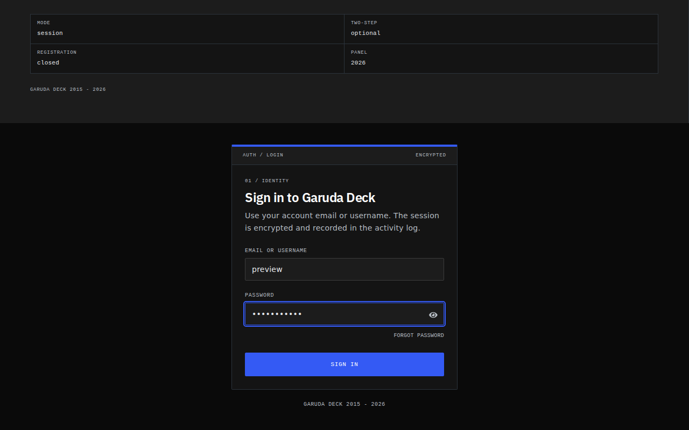
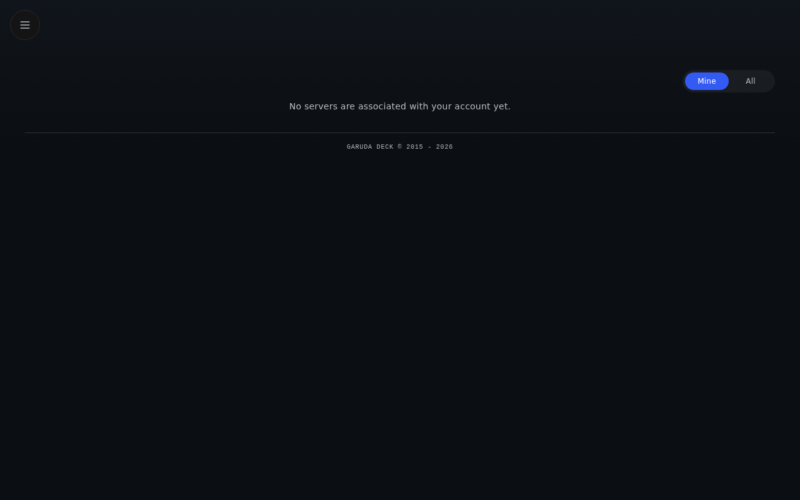
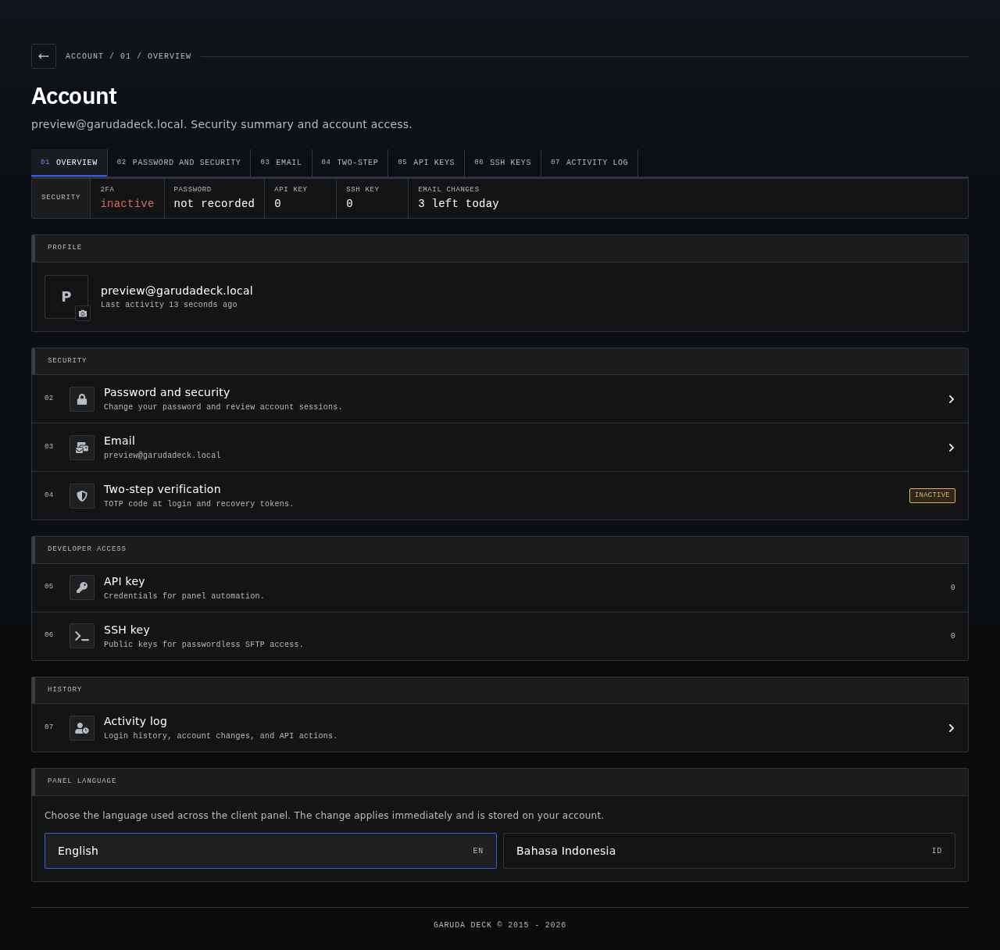

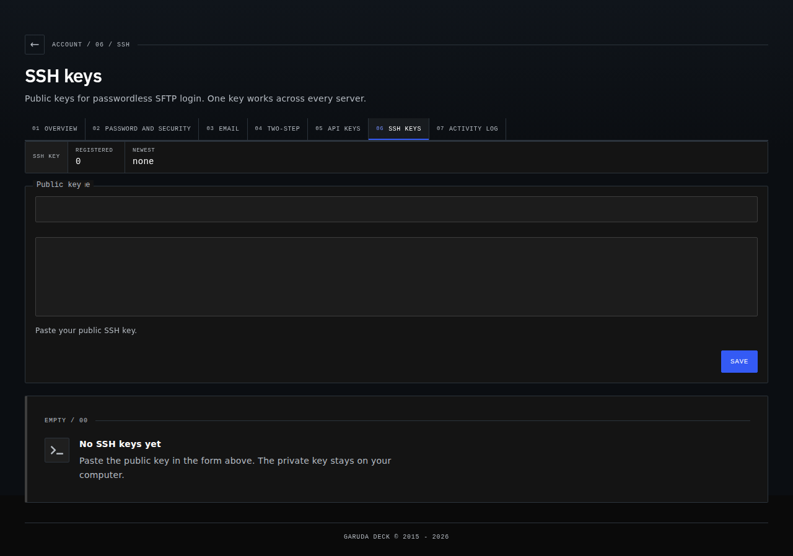
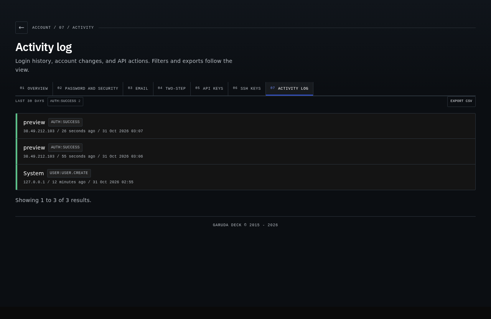
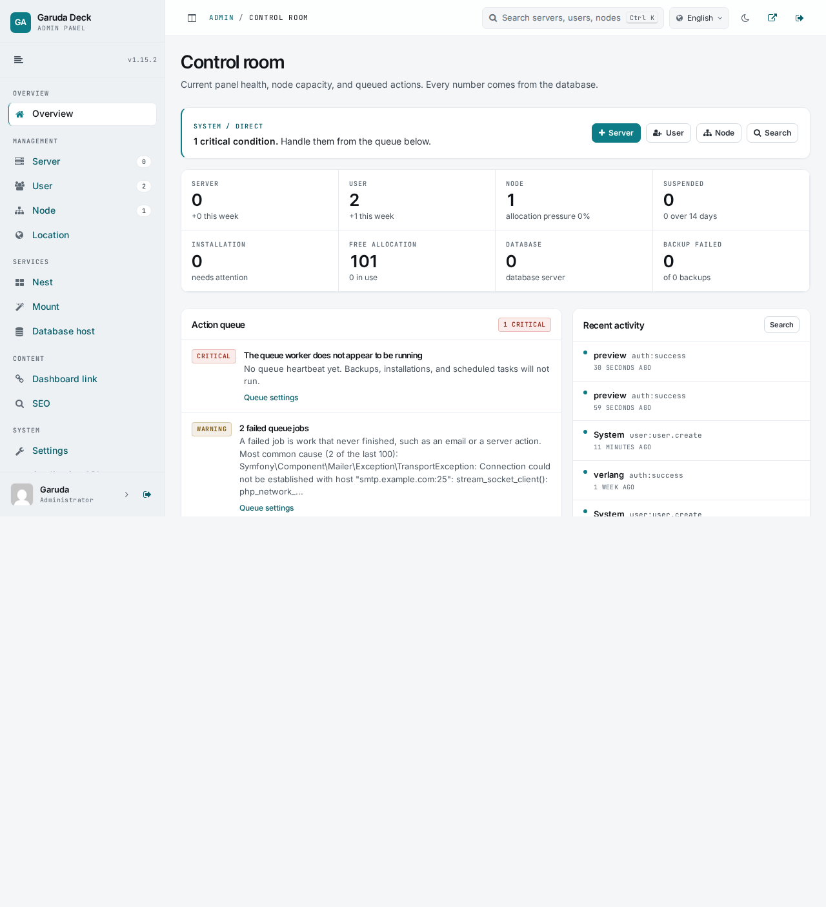
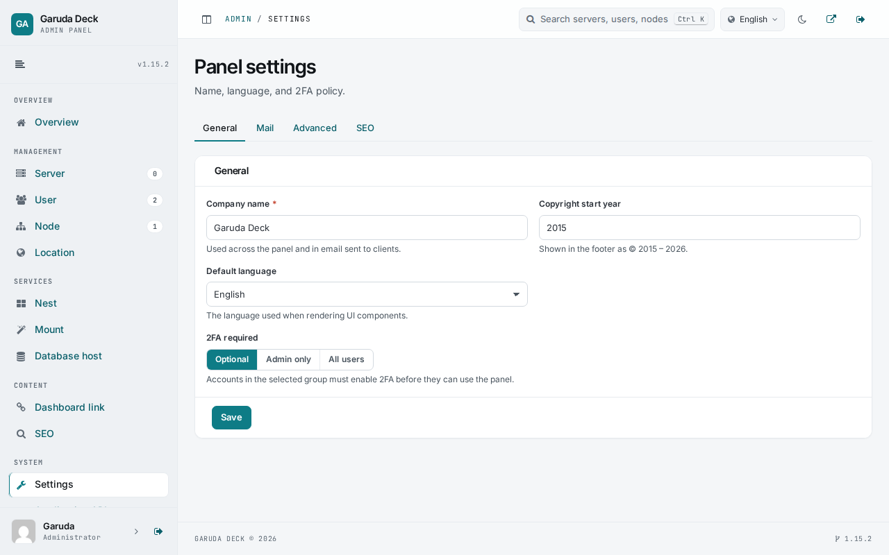


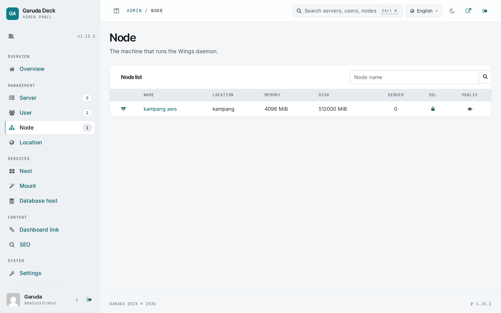
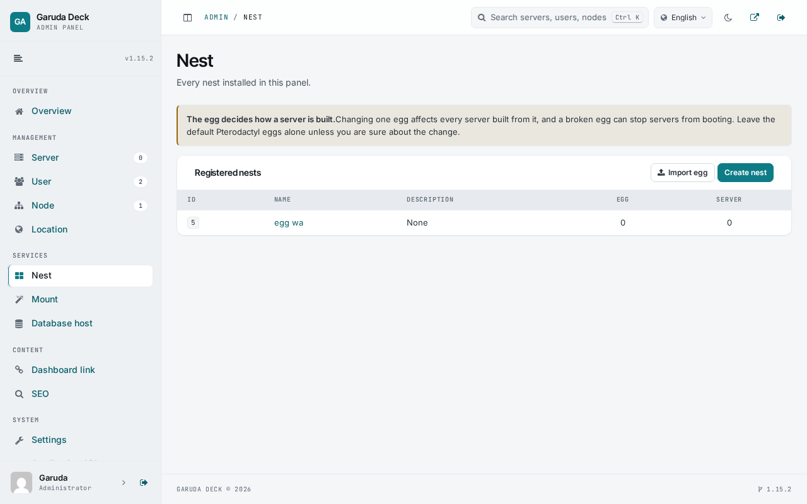
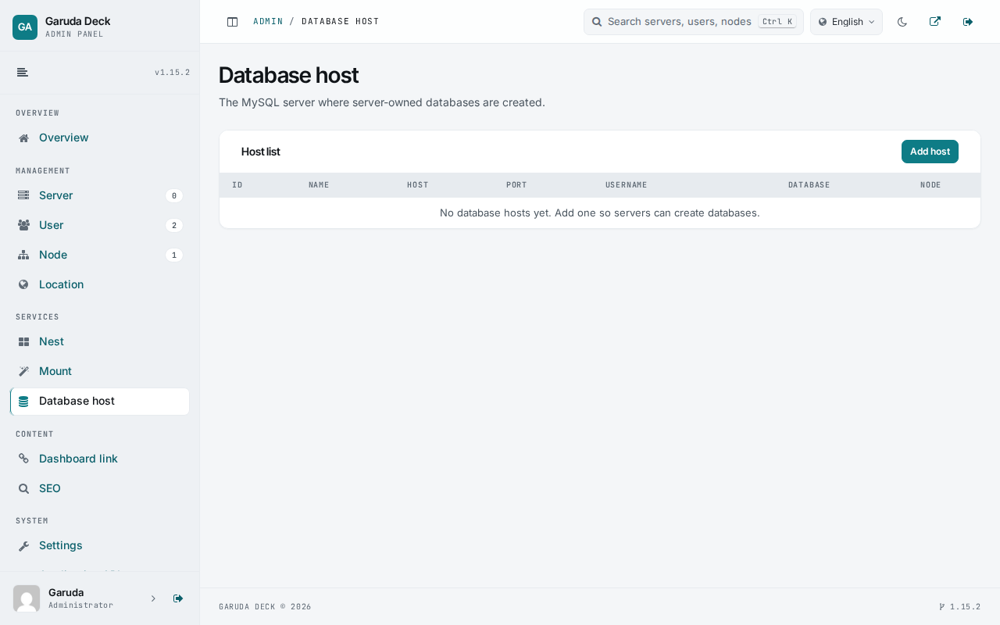
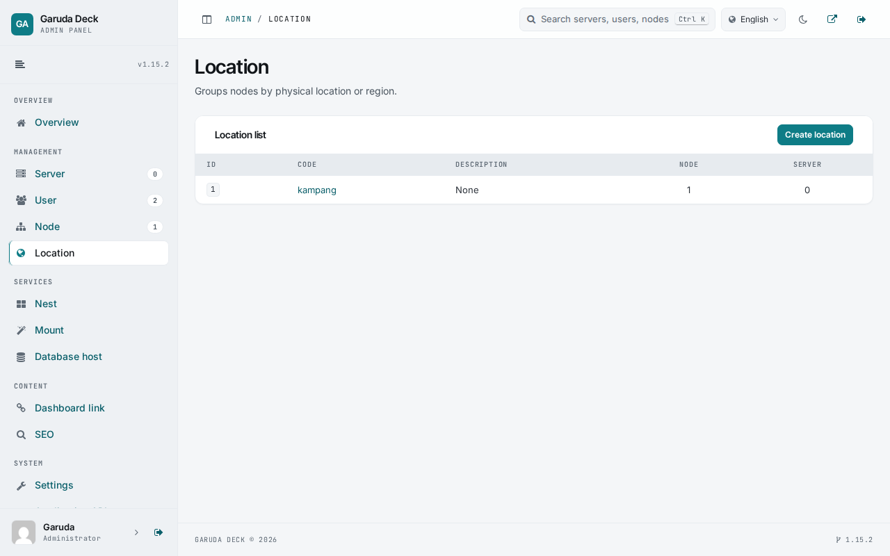


## Syarat

- Ubuntu 20.04, 22.04, 24.04 atau Debian 11, 12.
- PHP 8.2 atau 8.3 dengan `pdo_mysql`.
- Panel 1.11 sampai 1.15.
- Root atau sudo, ruang disk minimal 300 MB.
- Node dan yarn tidak dibutuhkan di VPS tujuan.

## Backup dan rollback

Backup tersimpan otomatis sebelum install. Rollback manual lewat menu nomor 4. Matikan rollback otomatis dengan `AUTO_ROLLBACK=0`.

## Lisensi

MIT. Dibuat oleh **verlangid** dari Indonesia.
