# GarudaDeck Theme

<p align="center">
  
</p>

<p align="center">
  
  
  
  
  
</p>

<p align="center"><b>Tema Pterodactyl buatan verlangid dari Indonesia.</b> Install satu baris bash tanpa token.</p>

<p align="center">Semua screenshot di bawah adalah capture nyata dari panel live <code>client.timpapanel.web.id</code>, bukan mockup.</p>

## Install 1 menit

```bash
curl -fsSL https://raw.githubusercontent.com/Verlangid11/garudadeck-theme/main/install.sh | bash
```

```bash
curl -fsSL https://raw.githubusercontent.com/Verlangid11/garudadeck-theme/main/install.sh | bash -s -- check
curl -fsSL https://raw.githubusercontent.com/Verlangid11/garudadeck-theme/main/install.sh | bash -s -- backup
curl -fsSL https://raw.githubusercontent.com/Verlangid11/garudadeck-theme/main/install.sh | bash -s -- rollback
```

## Galeri asli client area

| Login | Dashboard client |
| --- | --- |
|  | 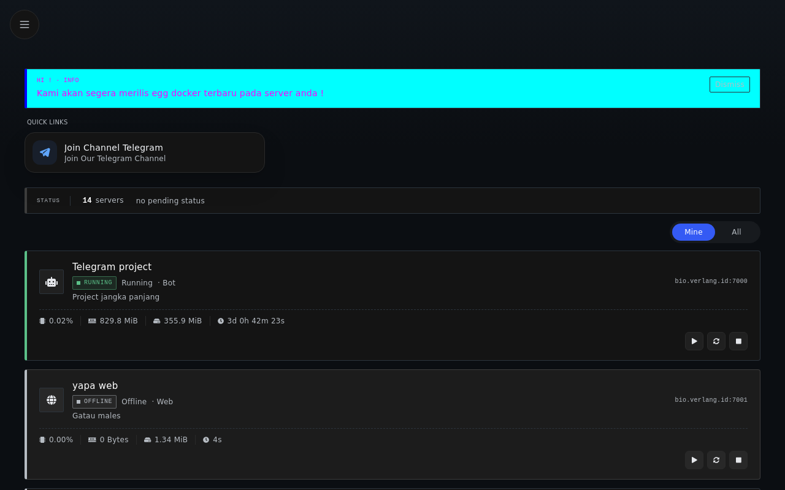 |

Login dengan logo GarudaDeck 36px di kiri atas. Dashboard menampilkan banner pengumuman info, quick link telegram, status 14 server, daftar server dengan tombol power.

| Console real time | File manager |
| --- | --- |
| 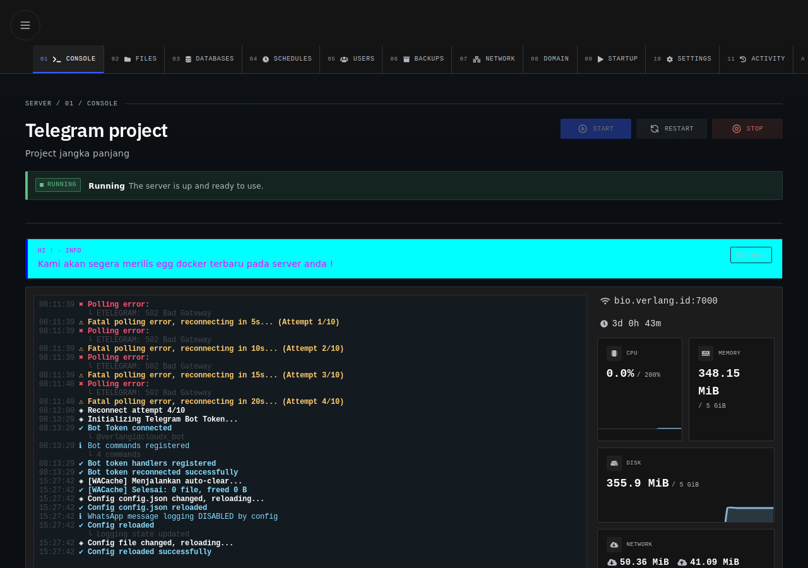 | 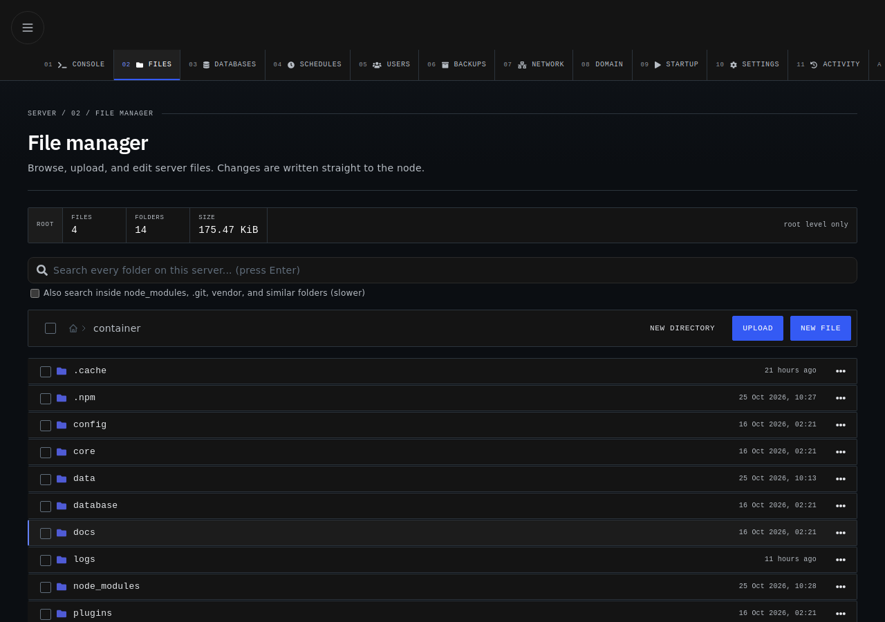 |

Console dengan sidebar 01 console sampai 11 activity plus domain di 08, tombol start restart stop, log streaming Telegram bot, panel resource CPU memory disk network. File manager dengan pencarian global, tombol upload new file new directory, daftar folder container lengkap.

| Databases | Schedules |
| --- | --- |
| 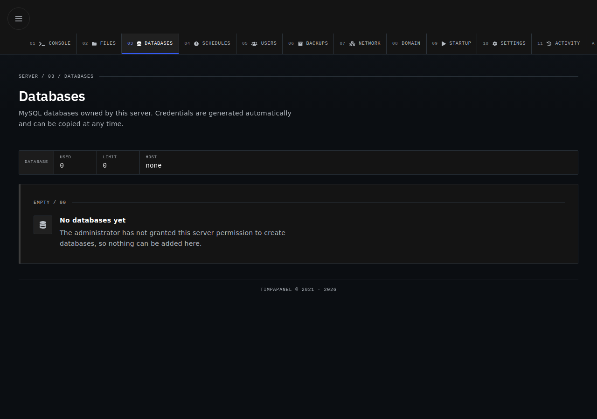 | 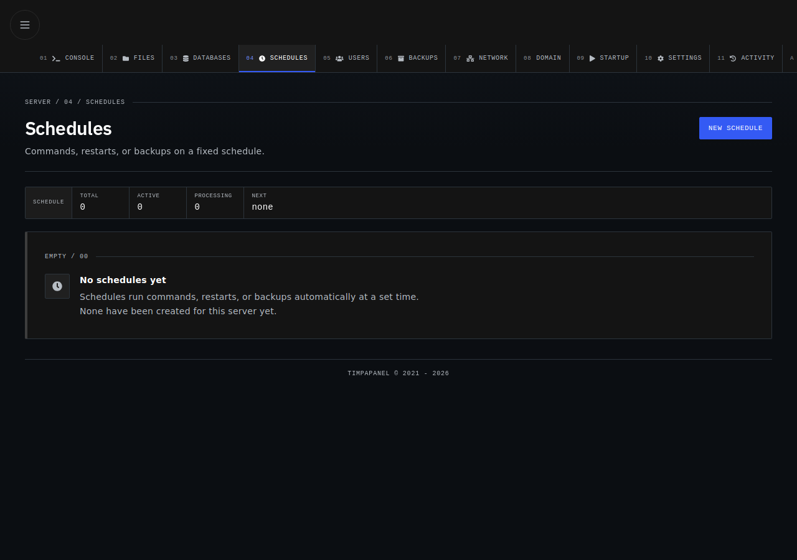 |

| Users | Backups |
| --- | --- |
| 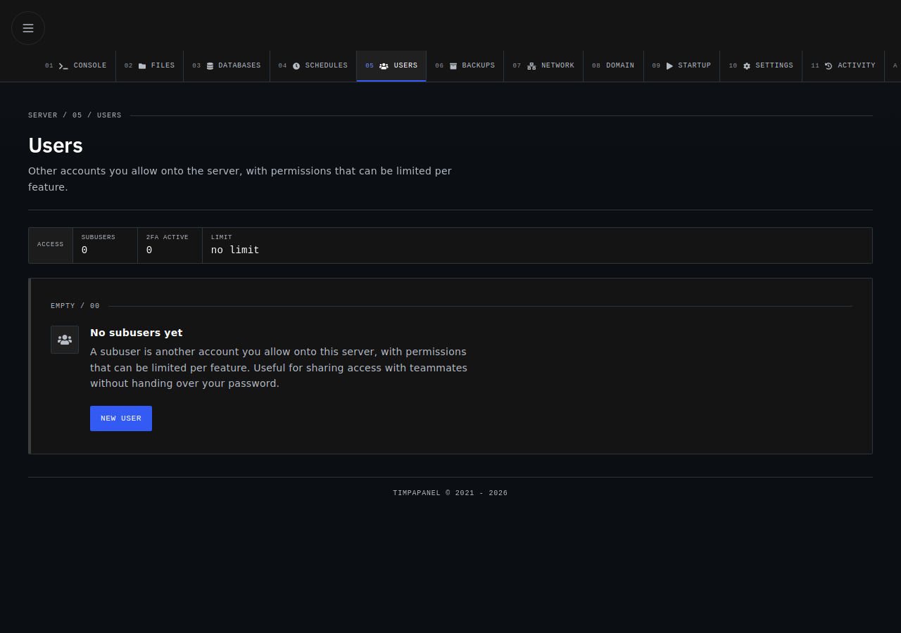 | 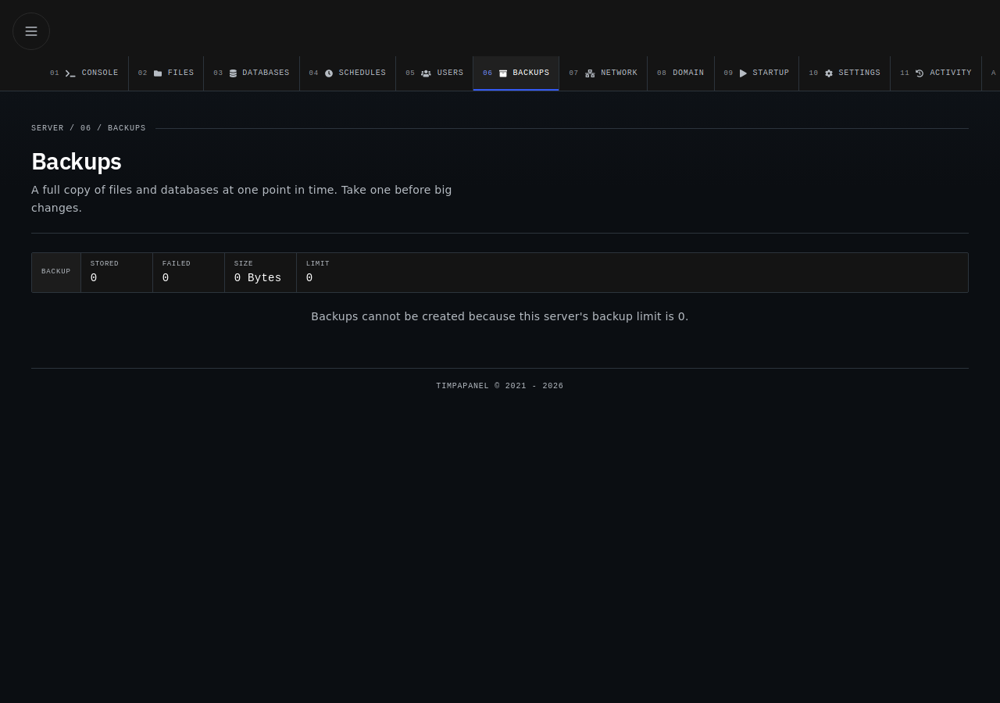 |

| Network | Startup |
| --- | --- |
| 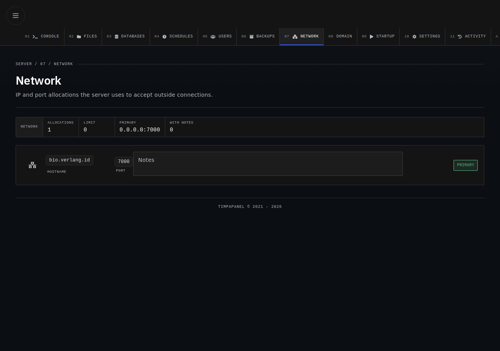 | 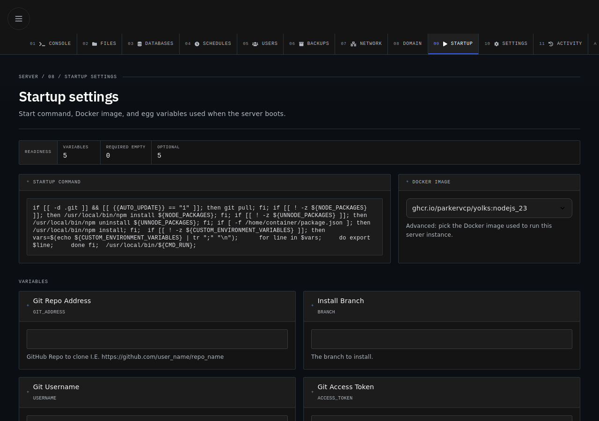 |

| Settings | Account |
| --- | --- |
| 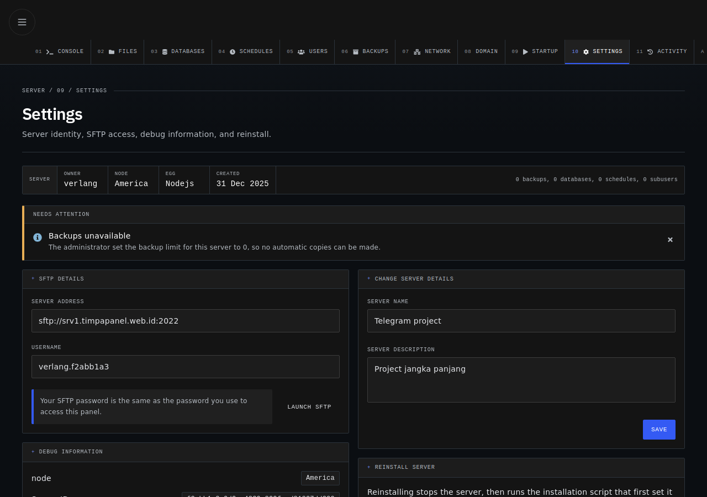 | 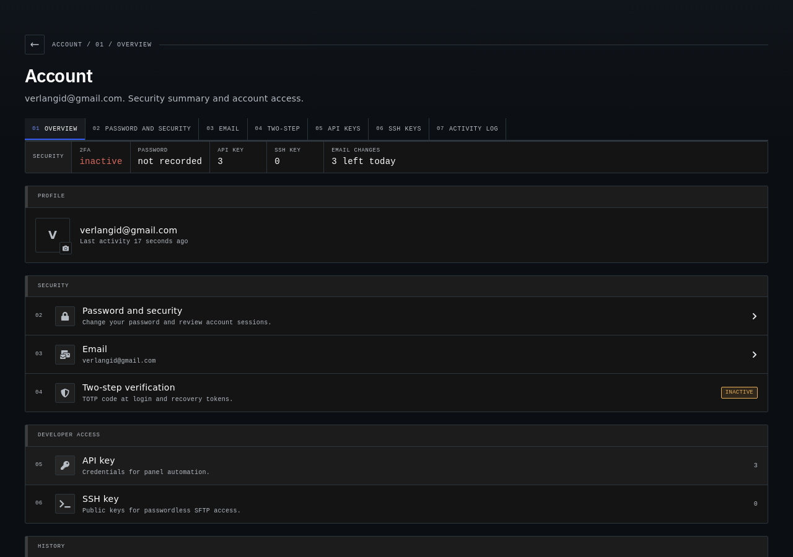 |

## Galeri asli admin panel

| Control room | Servers |
| --- | --- |
| 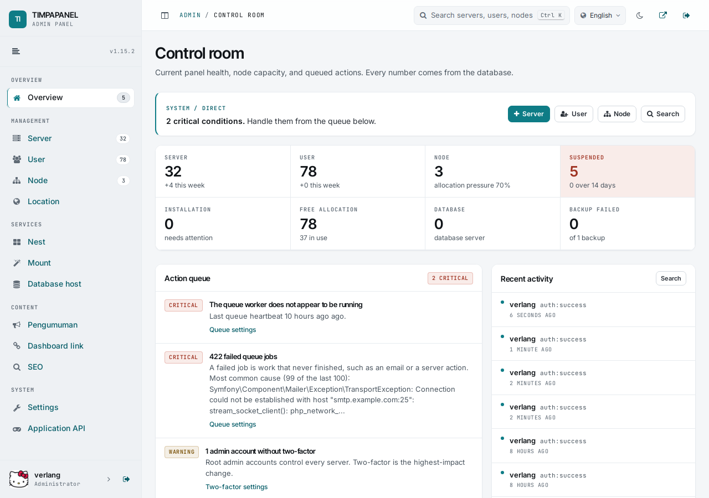 | 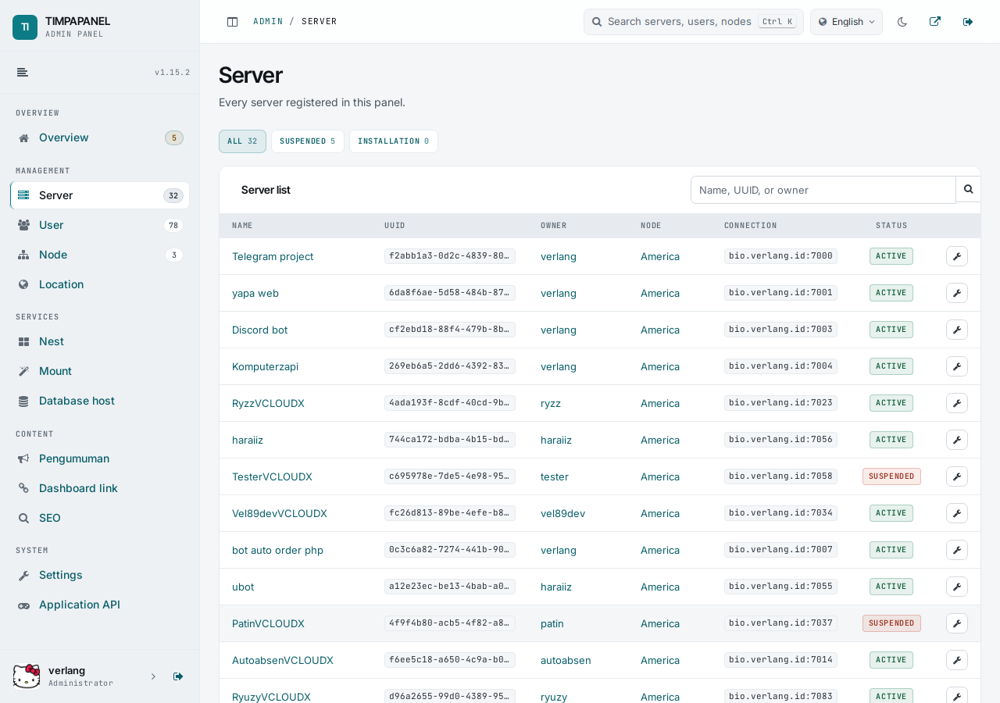 |

Control room menampilkan 32 server, 78 user, 3 node, action queue critical dan warning nyata. Servers menampilkan daftar lengkap dengan filter.

| Pengumuman |
| --- |
| 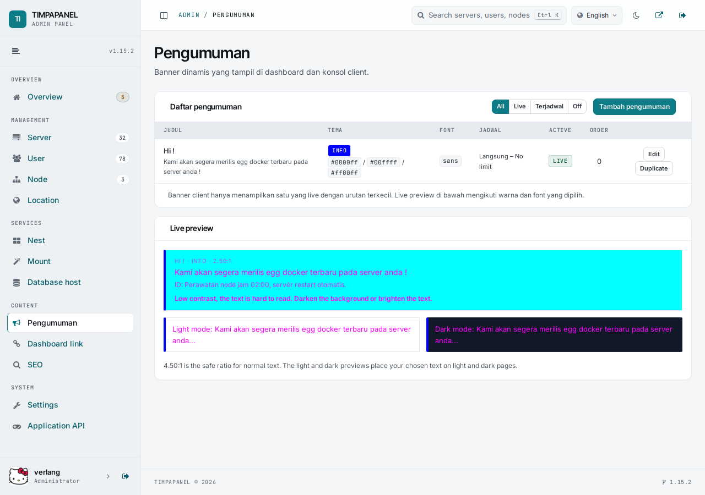 |

Halaman pengumuman dengan tabel judul tema font jadwal active order, plus live preview light dan dark mode dengan cek kontras 4.50:1. Banner client hanya menampilkan satu yang live dengan urutan terkecil.

## Fitur lengkap

- Console real time: log streaming, tombol power start stop restart kill, kartu resource CPU RAM disk network, sidebar 11 menu plus domain
- File manager: browse, upload, edit, rename, pindah, chmod, hapus massal, cari global, breadcrumb, info 4 files 14 folders 175 KB
- Database, backup, schedules, network, users, startup, settings, activity, semuanya asli dari panel Pterodactyl plus sentuhan GarudaDeck
- Domain kustom per server di menu 08 domain: verifikasi TXT dan A, recheck tiap 30 menit
- Pengumuman global: admin kelola, client lihat satu banner live dengan sort terkecil, dukung EN dan ID
- Branding: logo Garuda di login, favicon 33 file, komponen GarudaLogo
- Installer: cek OS panel PHP, backup kode plus DB, gagal otomatis rollback

## Syarat VPS

- OS: Ubuntu 20.04, 22.04, 24.04, Debian 11, 12
- Panel 1.11 sampai 1.15 di `/var/www/pterodactyl`
- PHP 8.2 atau 8.3, curl, tar, python3

Tutorial lengkap: TUTORIAL.md
