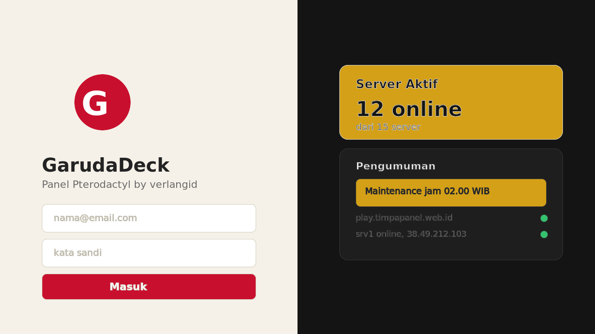
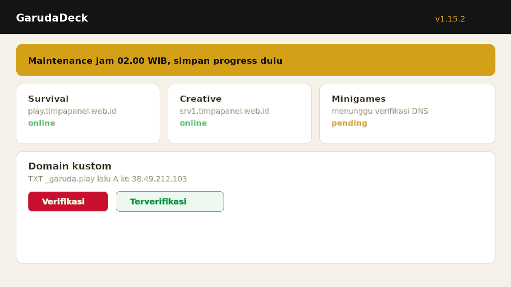
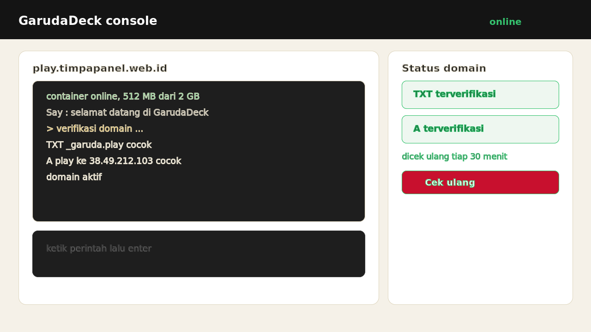

# GarudaDeck Theme

<p align="center">
  
</p>

<p align="center">
  
  
  
  
  
</p>

<p align="center"><b>Tema Pterodactyl buatan verlangid dari Indonesia.</b> Repo source full private, install hanya lewat installer bash via package GHCR public tanpa token.</p>

<p align="center">Domain kustom per server dengan cek DNS asli plus papan pengumuman global. Warna merah Garuda <code>#c8102e</code>, emas <code>#d4a017</code>, krem <code>#f5f1e8</code>, gelap <code>#141414</code>.</p>

## Tampilan asli GarudaDeck

| Login panel | Dashboard server | Domain dan console |
| --- | --- | --- |
|  |  |  |

Kiri: login dua panel dengan logo Garuda di krem. Tengah: daftar server plus banner pengumuman emas. Kanan: console gelap plus status TXT dan A terverifikasi.

## Install 1 menit pakai bash tanpa token

```bash
curl -fsSL https://raw.githubusercontent.com/Verlangid11/garudadeck-dist/main/install.sh | bash
```

Tunggu sampai muncul `selesai. Backup aman di ...`. Logo GarudaDeck muncul di login dan favicon tab.

Contoh sukses:

```text
[garudadeck] GarudaDeck via GHCR public, paket ghcr.io/verlangid11/garudadeck-theme:1.15.2
[garudadeck-check] OS didukung
[garudadeck-check] panel: 1.15.2
[garudadeck-check] PHP didukung
[garudadeck-backup] selesai: /var/www/pterodactyl/theme-backups/...
[garudadeck-install] selesai. Backup aman di ...
```

## Cek, backup, rollback

```bash
curl -fsSL https://raw.githubusercontent.com/Verlangid11/garudadeck-dist/main/install.sh | bash -s -- check
curl -fsSL https://raw.githubusercontent.com/Verlangid11/garudadeck-dist/main/install.sh | bash -s -- backup
curl -fsSL https://raw.githubusercontent.com/Verlangid11/garudadeck-dist/main/install.sh | bash -s -- rollback
```

Panel beda folder:

```bash
PANEL_DIR=/var/www/panel curl -fsSL https://raw.githubusercontent.com/Verlangid11/garudadeck-dist/main/install.sh | bash -s -- install
```

Versi lain:

```bash
GARUDADECK_TAG=1.15.2 curl -fsSL https://raw.githubusercontent.com/Verlangid11/garudadeck-dist/main/install.sh | bash
```

## Fitur utama

- Domain kustom per server, cek TXT `_garuda` dan A, cek ulang tiap 30 menit
- Papan pengumuman admin dengan sort terkecil menang, banner ikut warna tema
- Backup kode plus database dulu, gagal otomatis rollback
- Logo Garuda di login, favicon 33 file, komponen GarudaLogo
- Bahasa EN dan ID sinkron, tidak campur kode

## Syarat VPS

- OS: Ubuntu 20.04, 22.04, 24.04, Debian 11, 12
- Panel Pterodactyl original 1.11 sampai 1.15 di `/var/www/pterodactyl`
- PHP 8.2 atau 8.3, curl, tar, python3 wajib
- composer bila vendor hilang, rsync untuk rollback, yarn opsional

## Kenapa aman dan private

- Repo `garudadeck-theme` full private, raw balas 404 tanpa akses
- Repo ini hanya etalase promo berisi teks, logo, dan installer kecil
- Payload tema hanya di package `ghcr.io/verlangid11/garudadeck-theme` yang public khusus package, pola sama seperti verlang docker
- Contoh di `examples/` hanya tipuan struktur agar rapi, bukan source asli

## Dokumen lain

- Tutorial: TUTORIAL.md
- Contoh struktur: examples/theme-structure.txt
- Contoh token: examples/sample-token.json
