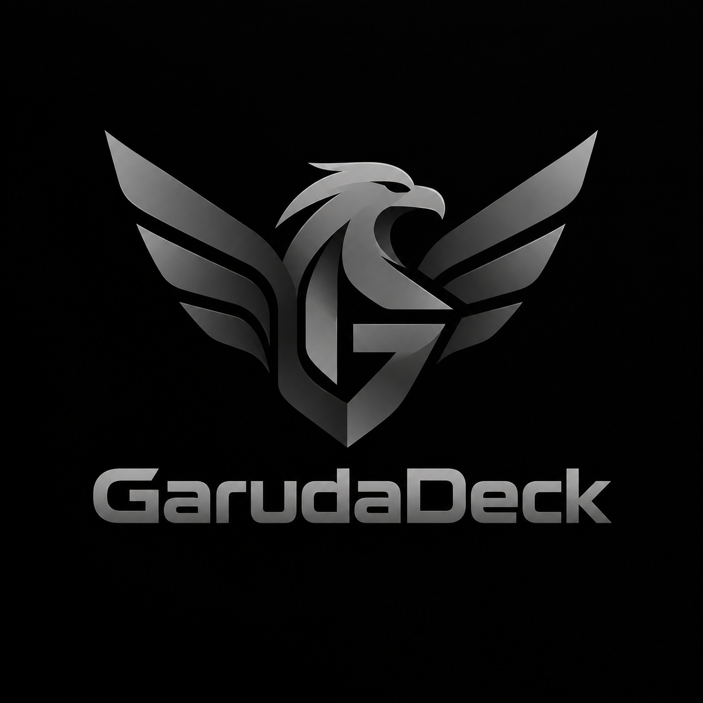
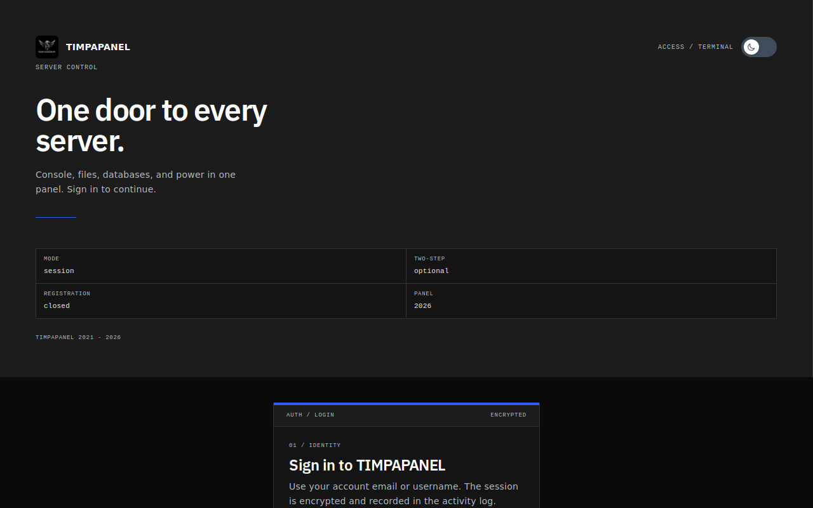
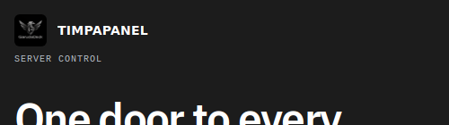

# GarudaDeck Theme

<p align="center">
  
</p>

<p align="center">
  
  
  
  
  
</p>

<p align="center"><b>Tema Pterodactyl buatan verlangid dari Indonesia.</b> Install satu baris bash tanpa token.</p>

<p align="center">Domain kustom per server dengan cek DNS asli plus papan pengumuman global. Warna merah Garuda <code>#c8102e</code>, emas <code>#d4a017</code>, krem <code>#f5f1e8</code>, gelap <code>#141414</code>.</p>

## Bukti asli dari panel live

Capture nyata dari `client.timpapanel.web.id`, bukan mockup. Logo GarudaDeck 36px sudah kepasang di kiri atas, build frontend sukses, favicon 200 OK.

<p align="center">
  
</p>

<p align="center">
  
</p>

## Install 1 menit

```bash
curl -fsSL https://raw.githubusercontent.com/Verlangid11/garudadeck-theme/main/install.sh | bash
```

```bash
curl -fsSL https://raw.githubusercontent.com/Verlangid11/garudadeck-theme/main/install.sh | bash -s -- check
curl -fsSL https://raw.githubusercontent.com/Verlangid11/garudadeck-theme/main/install.sh | bash -s -- backup
curl -fsSL https://raw.githubusercontent.com/Verlangid11/garudadeck-theme/main/install.sh | bash -s -- rollback
```

## Fitur lengkap

- Console real time ala vscode: log streaming, tombol power start stop restart kill, indikator resource CPU RAM disk, panel instrumen dan uptime
- File manager keren: browse, upload, edit, rename, pindah, chmod, hapus massal, cari global, breadcrumb, status folder
- Database: buat database, rotate password, salin kredensial aman
- Backup: buat dan kelola backup server, unduh dan restore
- Jadwal: cron schedule plus task otomatis dengan editor visual
- Jaringan: alokasi IP port, assign dan hapus alokasi
- Pengguna: subuser dengan permission granular per fitur
- Startup: editor variable startup plus docker image
- Settings: rename server dan reinstall dengan konfirmasi aman
- Domain kustom per server: form tambah domain, verifikasi TXT `_garuda` dan A, recheck otomatis tiap 30 menit, throttle anti spam
- Pengumuman global: admin buat pengumuman, tampil sebagai banner ikut warna tema, satu pemenang aktif terkecil sort, dukung EN dan ID
- Branding GarudaDeck: logo di login, favicon 33 file, komponen GarudaLogo reusable, patch login idempoten
- Installer aman: cek OS panel PHP sebelum ubah, backup kode plus DB dengan MANIFEST, gagal otomatis rollback, verifikasi syntax dan route

## Syarat VPS

- OS: Ubuntu 20.04, 22.04, 24.04, Debian 11, 12
- Panel 1.11 sampai 1.15 di `/var/www/pterodactyl`
- PHP 8.2 atau 8.3, curl, tar, python3
- Tutorial lengkap: TUTORIAL.md
